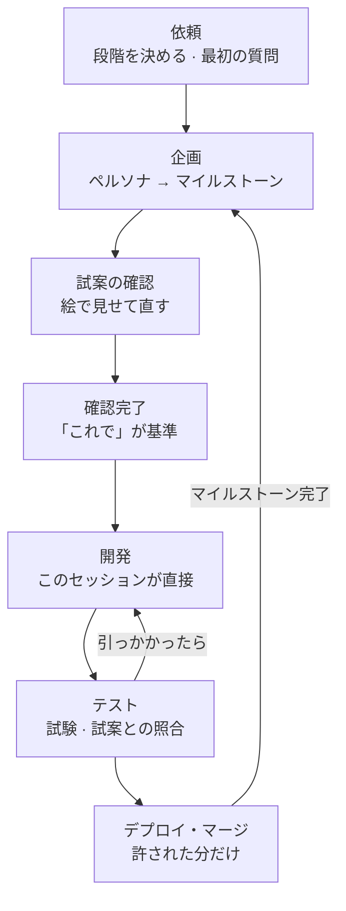

[English](README.md) | [한국어](README.ko.md) | **日本語**

# claude-haejo

**「Claude、〜して」** のひと言を聞いて、合った段階から最後までやり切る Claude Code のスキルです。

🌱 紹介サイト: **https://ff-1204.github.io/claude-haejo/ja/**

- **ひとつの流れ**: 依頼 → 企画 → 試案の確認 → 確認完了 → 開発 → テスト → デプロイ・マージ。言葉に合った段階から始めます。
- **企画**: 「最初から企画して」→ ペルソナ（架空のユーザー）からマイルストーン（開発の段階）までを文書にします。
- **まず絵の試案**: 作る前に試案を絵で見せ、「これで」と言われてから作ります。
- **最初に一度だけ聞く**: 今回の作業に必要なことだけを1画面で聞きます。そのあとは、試案の確認と取り消しにくいこと以外では止まりません。

## はじめかた

1. Claude Code にこう貼り付けてください。
   ```text
   https://github.com/ff-1204/claude-haejo を取得してインストールして
   ```
2. 新しい Claude Code セッションを開きます。スキルは新しいセッションから有効になります。
3. プロジェクトのフォルダでこう言ってください: **「最初から企画して」**

スキルの本文は韓国語で書かれています。Claude はそれに従い、あなたの言語で答えます。

## なぜ使うのか

- **言葉に合った段階から始めます。** 「企画して」は企画から、「この機能を入れて」は試案から、「このバグを直して」は開発から、「マージして」はマージだけを行います。
- **何から作るかを人を基準に決めます。** ペルソナの一日の場面から必要な機能を取り出し、多くの人に必要なものから順番を付けます。
- **点数がぶれません。** 比重の点数は Claude が目で数えず、スクリプト（`score.js`）で数えます。
- **どこで止まっても続けられます。** 文書ごとに更新時刻があり、スクリプトが文書どうしの内容が合っているかも見るので、次のセッションはどの文書がなぜ古いかを見てそこから進めます。
- **試案は絵で、結果は試案どおりに。** 画面・流れ・ルールのように目に見える結果は、作る前に絵の試案を見せ、終わったら項目ごとにできたかを表で見せます。
- **git は許された範囲だけ。** 最初に選んだ範囲（ファイルだけ / コミットまで / PR まで / マージまで）か、「コミットして」のように頼まれた分だけ行います。
- **「できました」だけを信じません。** 実行したコマンドと結果の行をそのまま残し、危険な変更は別のエージェントが変更内容だけを見てもう一度レビューします。
- **スマホでも読みやすく。** 報告は短く、選択肢には番号を付けます。

## こう言ってください

| こう言うと | 始まる段階 | こうなります |
|---|---|---|
| 「最初から企画して」 | 企画 | コア体験を確認してもらい、ペルソナ5人 → シナリオ → 点数 → 優先順位 → マイルストーンまで書きます |
| 「ペルソナをもう一人追加して: 週末だけ遊ぶ会社員」 | 企画 | その人とシナリオを追加し、後ろの文書は変わった所だけ直します |
| 「この機能を入れて」 | 試案の確認 | 絵の試案を見せ、「これで」と言われたら作ってテストします |
| 「M2を進めて」 | 開発 | M2 の残りの項目を順に作ってテストします。項目の「終わったと見なすこと」が基準です |
| 「このバグを直して」 | 開発 | 試案なしですぐ直してテストします |
| 「テストを繰り返して」 | テスト | 決めた時間のあいだ、テスト → 改善を繰り返します |
| 「コミットして」「マージして」 | デプロイ・マージ | 言われた分だけ行います |
| 「寝るね」 | — | 出かける前に必要なことだけ聞いて進め続けます。戻ったら決めることをまとめて見せます |
| 「ロードマップはどこまで進んだ？」 | — | マイルストーンごとの完了数と次の項目だけを伝えます。何も変更しません |

`/haejo` のようにスラッシュで呼ぶこともできます。スキルはこれひとつです。

## どう動くのか

### 全体の流れ



- 言葉によって入る場所が変わります。前の段階は飛ばします。
- テストで引っかかったら開発に戻り、試案そのものが間違っていたら試案の確認に戻ります。
- マイルストーンが終わるとシナリオを更新して点数を見直します。だから次にやることがいつも最新です。

### 最初の質問

依頼を読み、今回の作業がどこまで進むかを先に見てから、必要なことだけを1画面で聞きます。聞くことがなければ画面は出ません。

| 質問 | いつ出るか | 選ぶもの |
|---|---|---|
| git の範囲 | ファイルを直す作業のとき | ファイルだけ直す（おすすめ） / コミットまで / PR まで / マージまで |
| サブセッション | 1つの会話に収まらない大きな作業のとき | このセッションが直接（おすすめ） / サブセッションに任せる |
| 時間 | テストの繰り返しのように終わりが決まっていない作業のとき | 例: 3時間 / 6時間 |
| ほかに決めること | 上の質問があるとき、最後に | なし、すぐ始める（おすすめ） / 席を外します |

- もらった答えはそのセッションの最後まで使います。途中で聞き直しません。
- 許されていない git 作業が必要になったら行わず、最後の報告に「言ってくれればやります」と残します。
- モデルや、コミット末尾の `Co-Authored-By: Claude …` 行（既定は残す）などの残りは聞かずに既定値で決め、開始時の報告に1行で見せます。変えたいときは言葉で伝えれば、次からそうします。

### 開発とテスト

- **このセッションが直接やります。** サブセッション（別に動く Claude の会話）は、最初の質問で任せると選んだときか、「セッションを作ってやって」と言われたときだけ使います。
- **確定した試案が基準です。** 試案にないものは足さず、試案どおりにできない項目は理由と一緒に伝えます。
- **テストは証拠を残します。** 実行したコマンド・終了コード・結果の行をそのまま書き、試案の項目ごとに「できた / できていない / 違う形でできた」を書きます。
- **危険な変更**（複数の機能が共有する保存・通信のコード、形式・バージョンの変更、ログイン・決済・秘密の値、消すコード）は、別のエージェントが変更内容と基準だけを見てもう一度レビューします。
- コミット・PR・マージをする場合、マージは squash で行います。コミットの題名は `feat: ログイン画面を追加` のように種類（feat・fix・docs など）を前に付けます。

## ユーザーが決めること

残りは Claude が決めて報告しますが、これらはユーザーが決めます。

- **コア体験や画面の文言のような好み**: 人が見て感じるものなので、Claude が代わりに決めません。試案に入れてまとめて確認してもらいます。
- **決済・アカウント**: お金とアカウントはユーザーだけが扱います。
- **git**: **コミット**（変更を記録として残す）、**push**（その記録を GitHub に上げる）、**PR**（変更を取り込んでよいか尋ねる依頼）、**マージ**（PR を本流の main に取り込む）は、最初の質問で選んだ範囲か、頼まれた分だけ行います。既定は「ファイルだけ直す」です。
- **タグ**（ある時点に付ける名札、例: `v1.0`）: 「タグを付けて」と頼まれたときだけ付けます。

## インストール・アップデート

必要なもの: [Claude Code](https://claude.com/claude-code)、[Git](https://git-scm.com/)、Node.js（点数の計算）、[GitHub CLI](https://cli.github.com/) `gh`（PR の作成。なければ push まで）。

Claude Code に言葉で頼めば済みます。どれも **新しいセッションから** 有効になります。

| こう言うと | Claude がすること |
|---|---|
| `https://github.com/ff-1204/claude-haejo を取得してインストールして` | リポジトリを clone し、`install.sh`（Windows は `install.ps1`）を実行してスキルを `~/.claude/skills/` にコピーします |
| `claude-haejo をアップデートして` | `git pull` で取得し、変わるファイルを `--check` で先に見せてから入れ直します |
| `claude-haejo のインストール状態を確認して` | `--check` で、リポジトリとインストール済みのものが違うファイルだけを伝えます。何もコピーしません |

- `~/.claude/CLAUDE.md` がすでにあれば上書きせず、違う行だけを見せます。入れるかどうかはご自身で選んでください。
- この PC だけに置くルール（`*.local.md`）は上書きしません。削除するのは、`--prune` が `haejo` へ移し終えた古いコピーを片付けるときだけです。
- **以前のバージョンから上げるとき**: スキルは `haejo` ひとつにまとまりました。古いスキルのフォルダ（`roadmap`、`roadmap-teammate`、`roadmap-core` など9つ）が残っていると、インストール・確認のときに知らせます。残っていると古いスキルが呼ばれ続けることがあるので、`./install.sh --prune`（PowerShell: `-Prune`）で消してください。古いフォルダにあった `*.local.md` はインストール時に `haejo` フォルダの同じ場所へコピーされ、コピーのない `*.local.md` が入ったフォルダは消しません。
- 新しいバージョンが出ると、スキルを使ったときに報告の最後へ1行で知らせます。確認は1日1回、GitHub にタグの一覧だけを問い合わせ、自動では取得しません。取得するには `claude-haejo をアップデートして` と言ってください。

<details>
<summary>コマンドを自分で実行するなら</summary>

```bash
git clone https://github.com/ff-1204/claude-haejo.git
cd claude-haejo
./install.sh             # Windows PowerShell: powershell -ExecutionPolicy Bypass -File .\install.ps1
./install.sh --check     # コピーせず違うファイルだけ見る (PowerShell: -Check)
./install.sh --dry-run   # コピーするファイルだけ見る (PowerShell: -DryRun)
./install.sh --prune     # 古いスキルのフォルダだけ消す (PowerShell: -Prune)
git pull && ./install.sh # アップデート
```

</details>

## もっと知る（韓国語）

- 全体の流れ、最初の質問、git の範囲: [skills/haejo/SKILL.md](skills/haejo/SKILL.md)
- 企画の流れと質問する場面: [plan.md](skills/haejo/references/plan.md)
- 作る文書5つと共通ルール: [rules.md](skills/haejo/references/rules.md)
- 絵の試案と試案との照合: [mockup.md](skills/haejo/references/mockup.md)
- テストと危険な変更のレビュー: [test.md](skills/haejo/references/test.md)
- 公開してはいけない個人ルール（`*.local.md`）の書き方: [projects.md](skills/haejo/references/projects.md)

## ライセンス

[MIT](LICENSE)
