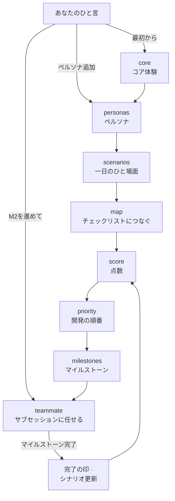
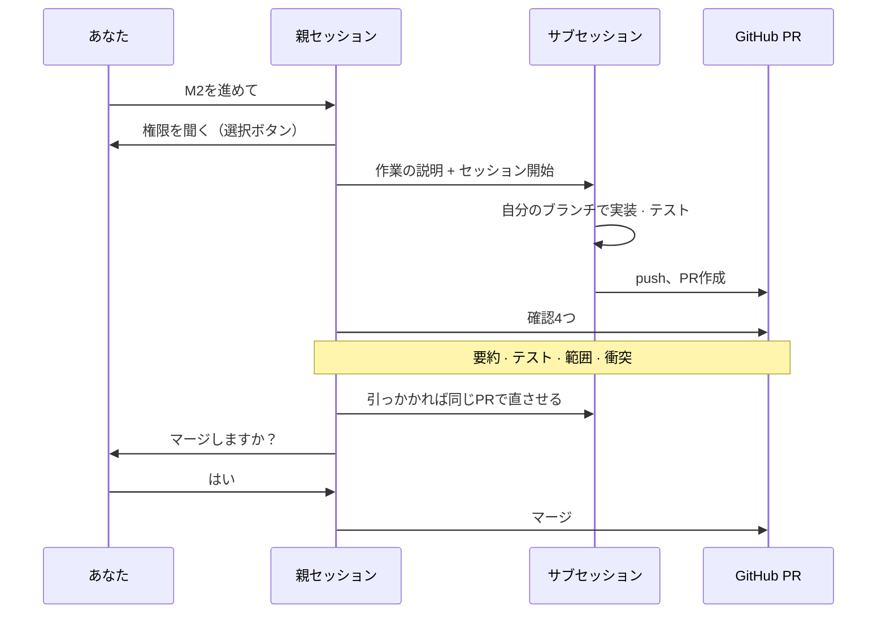

[English](README.md) | [한국어](README.ko.md) | **日本語**

# claude-haejo

**「Claude、〜して」** のひと言で、企画から開発までを任せられる Claude Code のスキル集です。

🌱 紹介サイト: **https://ff-1204.github.io/claude-haejo/ja/**

- **企画**: 「最初から企画して」→ ペルソナ（架空のユーザー）からマイルストーン（開発の段階）までを文書にします。
- **開発を任せる**: 「M2を進めて」→ 作業をサブセッション（別に動く Claude の会話）にチームメンバーのように割り振り、結果を確かめて報告します。
- **決めることだけ聞く**: 進め方は Claude が決め、好み・お金・取り消しにくいことだけを選択ボタンで聞きます。

スキル本体は韓国語で書かれていますが、スキルが作る文書や質問はあなたの言語で書かれます（[rules.md](skills/roadmap/references/rules.md) の「쓰는 법（書き方）」）。

## はじめに

1. Claude Code にこう貼り付けてください。
   ```text
   https://github.com/ff-1204/claude-haejo をダウンロードしてインストールして
   ```
2. 新しい Claude Code セッションを開きます。スキルは新しいセッションから有効になります。
3. プロジェクトのフォルダでこう話しかけます: **「最初から企画して」**

## 使う理由

- **何から作るかを「人」で決めます。** ペルソナの一日の場面から必要な機能を拾い、必要とする人が多い順に並べます。
- **点数がぶれません。** 重みの点数は Claude が目で数えず、スクリプト（`score.js`）で数えます。
- **どこで途切れても続きから。** 文書ごとに更新時刻があり、次のセッションは古くなった文書を見つけてそこから再開します。
- **複数の作業を同時に、ぶつからずに。** 作業ひとつ = サブセッションひとつ = ブランチひとつ = PRひとつ。
- **報告をうのみにしません。** 親セッションが PR で要約・テスト・範囲・衝突の4つを自分で確かめてから、マージするか聞きます。
- **スマホで見ても楽です。** 報告は短く、選択肢には番号が付きます。

## こう話しかけてください

| こう言うと | こうなります |
|---|---|
| 「最初から企画して」 | コア体験を確認してから、ペルソナ5人 → シナリオ → 点数 → 優先順位 → マイルストーンまで書きます |
| 「ペルソナをもう一人追加して: 週末だけ遊ぶ会社員」 | その人とシナリオを足し、後ろの文書は変わるところだけ直します |
| 「M2を進めて」 | 残りの項目ごとにサブセッションひとつ = PR（変更を取り込んでよいか尋ねる依頼）ひとつで任せ、確認してからマージ（取り込み）するか聞きます |
| 「もう寝るね」 | 離れる前に権限だけ聞いて進め続けます。戻ったら決めることをまとめて見せます |
| 「ロードマップ、どこまで進んだ？」 | マイルストーンごとに終わった数と次の項目だけを伝えます。何も変更しません |

`/roadmap`、`/roadmap-teammate` のようにスラッシュで呼んでもかまいません。企画の段階ごとにサブスキル（`roadmap-core`、`-personas`、`-scenarios`、`-map`、`-score`、`-priority`、`-milestones`）があり、単独でも呼べます。

## どう動くか

### 企画の流れ



- 言葉によって入り口が変わります。「ペルソナをもう一人」は最初からやり直さず、personas から回ります。
- コア体験（ユーザーがこの製品でする3〜6のこと）は、「最後まで任せる」と言っても必ず確認します。ここが違うと、後ろがすべて無駄になるからです。
- 開発が終わるとシナリオを更新し、点数を見直します。だから次にやることはいつも最新です。

### サブセッションと PR



- サブセッションは自分のブランチ（本流から分かれた枝）で作業するので、いくつ同時に動いてもぶつかりません。
- 親セッションはコードを読み直さず、PR で4つだけ見ます: 要約が埋まっているか、テストが通るか、任せた範囲内か、衝突がないか。
- マージは squash で行います。PR ひとつが結果だけを書いたコミットひとつとして残ります。コミットの題は `feat: ログイン画面を追加` のように種類（feat・fix・docs など）を先頭に付けます。
- コード作業であなたが決めるのはふつう2か所です: 始めるときの権限と、マージ直前の「はい」（とマージ後にサブセッションをどうするか）。好みに関わるものは別に聞きます。

## 必ずあなたに聞くこと

ほかは Claude が決めて報告しますが、これらは聞きます。

- **コア体験や画面の文言などの好み**: 人が見て感じるものなので、Claude が代わりに決めません。
- **支払い・アカウント**: お金とアカウントはあなただけが扱います。
- **コミット**（変更を記録に残す）・**push**（その記録を GitHub に上げる）
- **PR**（変更を取り込んでよいか尋ねる依頼）・**マージ**（PR を本流 main に取り込む）
- **タグ**（ある時点に付ける名札、例: `v1.0`）

コミットからタグまでは記録に残り、人に見え、リリースにつながることがあります。だから「任せる」と言っても、スキルを使うたびに聞きます。タグは「タグを付けて」と頼んだときだけ付けます。選ぶのは3つです: **PRまで任せてマージは聞く**（おすすめ）/ 今回だけマージまで任せる / 毎回聞く。

同じ画面で、コミット末尾の `Co-Authored-By: Claude …` 行（トレーラー）も選べます: **残す**（おすすめ）/ 外して本文に「Claude で進めた」と1行 / どちらも外す。

## インストール・アップデート

必要なもの: [Claude Code](https://claude.com/claude-code)、[Git](https://git-scm.com/)、Node.js（点数計算）、[GitHub CLI](https://cli.github.com/) `gh`（PR作成。なければ push まで）。

Claude Code に話しかけるだけです。どれも **新しいセッションから** 有効になります。

| こう言うと | Claude がすること |
|---|---|
| `https://github.com/ff-1204/claude-haejo をダウンロードしてインストールして` | リポジトリを clone し、`install.sh`（Windows は `install.ps1`）を実行して、スキルを `~/.claude/skills/` にコピーします |
| `claude-haejo をアップデートして` | `git pull` で取得し、変わるファイルを `--check` で先に見せてから入れ直します |
| `claude-haejo のインストール状態を確認して` | `--check` で、リポジトリとインストール済みのものが違うファイルだけを伝えます。何もコピーしません |

- `~/.claude/CLAUDE.md` がすでにあれば上書きせず、違う行だけを見せます。入れるかどうかはご自身で選んでください。
- この PC だけに置くルール（`*.local.md`）はコピーも削除もしません。

<details>
<summary>コマンドを自分で実行するなら</summary>

```bash
git clone https://github.com/ff-1204/claude-haejo.git
cd claude-haejo
./install.sh             # Windows PowerShell: powershell -ExecutionPolicy Bypass -File .\install.ps1
./install.sh --check     # コピーせず違うファイルだけ見る (PowerShell: -Check)
./install.sh --dry-run   # コピーするファイルだけ見る (PowerShell: -DryRun)
git pull && ./install.sh # アップデート
```

</details>

## もっと知る（韓国語）

- 企画の流れと質問する場面: [skills/roadmap/SKILL.md](skills/roadmap/SKILL.md)
- 作る文書5つと共通ルール: [skills/roadmap/references/rules.md](skills/roadmap/references/rules.md)
- サブセッション・PR・マージ、テストの繰り返し、留守中の作業: [skills/roadmap-teammate/SKILL.md](skills/roadmap-teammate/SKILL.md)
- 公開してはいけない個人ルール（`*.local.md`）の書き方: [projects.md](skills/roadmap-teammate/references/projects.md)
