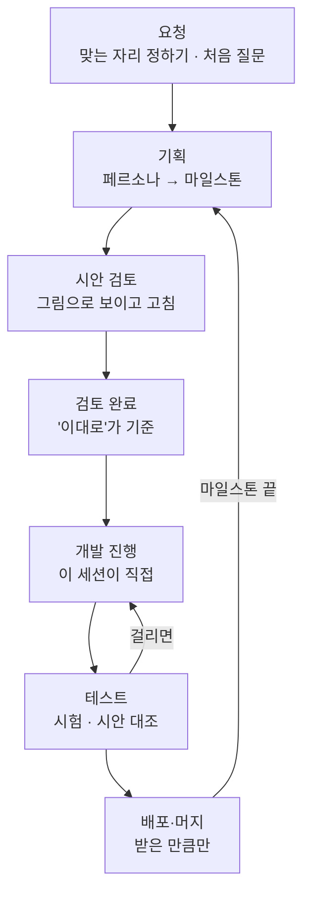

[English](README.md) | **한국어** | [日本語](README.ja.md)

# claude-haejo

**"클로드, ~해줘."** 한마디를 듣고 맞는 자리부터 끝까지 해 주는 Claude Code 스킬입니다.

🌱 소개 사이트: **https://ff-1204.github.io/claude-haejo/**

- **한 흐름**: 요청 → 기획 → 시안 검토 → 검토 완료 → 개발 진행 → 테스트 → 배포·머지. 말을 듣고 맞는 단계부터 시작합니다.
- **기획**: "처음부터 기획해줘" → 페르소나(가상의 사용자)부터 마일스톤(개발 단계)까지 문서로 만들어 줍니다.
- **그림 시안 먼저**: 만들기 전에 시안을 그림으로 보여 주고, "이대로"라고 하면 그때 만듭니다.
- **처음에 한 번만 묻기**: 이번 일에 필요한 것만 한 화면에 묻고, 그 뒤로는 멈추지 않습니다.

## 시작하기

1. Claude Code 창에 이렇게 붙여 넣으세요.
   ```text
   https://github.com/ff-1204/claude-haejo 를 받아서 설치해줘
   ```
2. 새 Claude Code 세션을 엽니다. 스킬은 새 세션부터 적용됩니다.
3. 프로젝트 폴더에서 이렇게 말하세요: **"처음부터 기획해줘"**

## 왜 쓰나

- **말에 맞는 자리부터 시작합니다.** "기획해줘"는 기획부터, "이 기능 넣어줘"는 시안부터, "이 버그 고쳐줘"는 개발부터, "머지해줘"는 머지만 합니다.
- **무엇부터 만들지 사람 기준으로 정합니다.** 페르소나의 하루 장면에서 필요한 기능을 뽑아, 많이 필요한 것부터 순서를 세웁니다.
- **점수가 흔들리지 않습니다.** 비중 점수는 Claude가 눈으로 세지 않고 스크립트(`score.js`)로 셉니다.
- **어디서 끊겨도 이어 합니다.** 문서마다 갱신 시각이 있고 스크립트가 문서끼리 내용이 맞는지도 봐서, 다음 세션이 어느 문서가 왜 낡았는지 보고 거기서부터 합니다.
- **시안은 그림으로, 결과는 시안대로.** 화면·흐름·규칙처럼 눈에 보이는 결과는 만들기 전에 그림 시안을 보여 주고, 끝나면 시안 항목마다 됐는지 표로 보여 줍니다.
- **git은 받은 만큼만 합니다.** 처음에 고른 범위(파일만 / 커밋까지 / PR까지 / 머지까지)나 "커밋해줘"처럼 시킨 만큼만 합니다.
- **"됐어요"만 믿지 않습니다.** 돌린 명령과 결과 줄을 그대로 남기고, 위험한 변경은 다른 에이전트가 바뀐 내용만 보고 한 번 더 검토합니다.
- **휴대폰으로 봐도 편합니다.** 보고는 짧게, 선택지는 번호를 붙여 보여 줍니다.

## 이렇게 말하세요

| 이렇게 말하면 | 시작하는 자리 | 이렇게 됩니다 |
|---|---|---|
| "처음부터 기획해줘" | 기획 | 핵심 경험을 확인받고, 페르소나 5명 → 시나리오 → 점수 → 우선순위 → 마일스톤까지 씁니다 |
| "페르소나 하나 더 추가해줘: 주말에만 하는 직장인" | 기획 | 그 사람과 시나리오를 더하고, 뒤 문서에서 바뀐 곳만 고칩니다 |
| "이 기능 넣어줘" | 시안 검토 | 그림 시안을 보여 주고, "이대로"라고 하면 만들고 테스트합니다 |
| "M2 진행해줘" | 개발 진행 | M2의 남은 항목을 차례로 만들고 테스트합니다. 항목의 "끝났다고 보는 것"이 기준입니다 |
| "이 버그 고쳐줘" | 개발 진행 | 시안 없이 바로 고치고 테스트합니다 |
| "테스트 반복해줘" | 테스트 | 정한 시간 동안 테스트 → 개선을 되풀이합니다 |
| "커밋해줘", "머지해줘" | 배포·머지 | 말한 만큼만 합니다 |
| "자러 갈게" | — | 떠나기 전에 필요한 것만 묻고 계속 진행합니다. 돌아오면 정할 것을 모아 보여 줍니다 |
| "로드맵 어디까지 왔어?" | — | 마일스톤마다 끝난 수와 다음 항목만 알려 줍니다. 아무것도 고치지 않습니다 |

`/haejo`처럼 슬래시로 불러도 됩니다. 스킬은 이것 하나입니다.

## 어떻게 움직이나

### 전체 흐름



- 말에 따라 들어가는 곳이 다릅니다. 앞 단계는 건너뜁니다.
- 테스트에서 걸리면 개발로 돌아가고, 시안 자체가 틀렸으면 시안 검토로 돌아갑니다.
- 마일스톤이 끝나면 시나리오를 갱신하고 점수를 다시 봅니다. 그래서 다음에 할 일이 늘 최신입니다.

### 처음 질문

요청을 읽고 이번 일이 어디까지 갈지 미리 본 뒤, 필요한 것만 한 화면에 묻습니다. 물을 것이 없으면 화면을 띄우지 않습니다.

| 질문 | 언제 나오나 | 고르는 것 |
|---|---|---|
| git 범위 | 파일을 고치는 일일 때 | 파일만 고침(추천) / 커밋까지 / PR까지 / 머지까지 |
| 하위 세션 | 한 대화에 다 안 들어갈 큰 일일 때 | 이 세션이 직접(추천) / 하위 세션에 맡기기 |
| 시간 | 테스트 반복처럼 끝이 안 정해진 일일 때 | 예: 3시간 / 6시간 |
| 더 정해 둘 것 | 위 질문이 있을 때 맨 끝에 | 없음, 바로 시작(추천) / 자리를 비울 거예요 |

- 받은 답은 그 세션 끝까지 씁니다. 중간에 다시 묻지 않습니다.
- 받지 않은 git 작업이 필요해지면 하지 않고, 마무리 보고에 "이건 말씀하시면 해요"로 남깁니다.
- 모델, 커밋 끝의 `Co-Authored-By: Claude …` 줄(꼬리표, 기본은 남기기) 같은 나머지는 묻지 않고 기본값으로 정해 시작 보고에 한 줄로 보여 줍니다. 바꾸고 싶으면 말로 하면 다음부터 그렇게 합니다.

### 개발과 테스트

- **이 세션이 직접 합니다.** 하위 세션(따로 도는 Claude 대화)은 처음 질문에서 맡기라고 했거나 "세션 만들어서 해줘"라고 할 때만 씁니다.
- **확정된 시안이 기준입니다.** 시안에 없는 것은 더하지 않고, 시안대로 못 하는 항목은 이유와 함께 알립니다.
- **테스트는 증거를 남깁니다.** 돌린 명령·종료 코드·결과 줄을 그대로 적고, 시안 항목마다 "됐음 / 안 됨 / 다르게 됨"을 적습니다.
- **위험한 변경**(여러 기능이 같이 쓰는 저장·네트워크 코드, 형식·버전 변경, 로그인·결제·비밀값, 지우는 코드)은 다른 에이전트가 바뀐 내용과 기준만 보고 한 번 더 검토합니다.
- 커밋·PR·머지를 하게 되면 머지는 squash로 합니다. 커밋 제목은 `feat: 로그인 화면 추가`처럼 종류(feat·fix·docs 등)를 앞에 붙입니다.

## 사용자가 정하는 곳

나머지는 Claude가 정하고 보고하지만, 이것들은 사용자가 정합니다.

- **핵심 경험·화면 문구 같은 취향**: 사람이 보고 느끼는 것이라 Claude가 대신 정하지 않습니다. 시안에 넣어 한꺼번에 확인받습니다.
- **결제·계정**: 돈과 계정은 사용자만 다룹니다.
- **git**: **커밋**(바뀐 내용을 기록으로 남기기), **push**(그 기록을 GitHub에 올리기), **PR**(변경을 합쳐도 되는지 묻는 요청서), **머지**(PR을 본 줄기 main에 합치기)는 처음 질문에서 고른 범위나 시킨 만큼만 합니다. 기본은 "파일만 고침"입니다.
- **태그**(특정 시점에 붙이는 이름표, 예: `v1.0`): "태깅해줘"처럼 달아 달라고 할 때만 답니다.

## 설치·업데이트

필요한 것: [Claude Code](https://claude.com/claude-code), [Git](https://git-scm.com/), Node.js(점수 계산), [GitHub CLI](https://cli.github.com/) `gh`(PR 만들기, 없으면 push까지만).

Claude Code 창에 말로 하면 됩니다. 어느 것이든 **새 세션부터** 적용됩니다.

| 이렇게 말하면 | Claude가 하는 일 |
|---|---|
| `https://github.com/ff-1204/claude-haejo 를 받아서 설치해줘` | 저장소를 clone하고 `install.sh`(Windows는 `install.ps1`)를 돌려 스킬을 `~/.claude/skills/`에 복사합니다 |
| `claude-haejo 업데이트해줘` | `git pull`로 받은 뒤 `--check`로 바뀔 파일을 먼저 보여 주고 다시 설치합니다 |
| `claude-haejo 설치 상태 확인해줘` | `--check`로 저장소와 설치본이 다른 파일만 알려 줍니다. 아무것도 복사하지 않습니다 |

- `~/.claude/CLAUDE.md`가 이미 있으면 덮지 않고 다른 줄만 보여 줍니다. 넣을지는 직접 고르세요.
- 이 PC에만 두는 규칙(`*.local.md`)은 덮지도 지우지도 않습니다.
- **예전 버전에서 올라올 때**: 스킬이 `haejo` 하나로 합쳐졌습니다. 옛 스킬 폴더(`roadmap`, `roadmap-teammate`, `roadmap-core` 등 9개)가 남아 있으면 설치·확인 때 알려 줍니다. 남아 있으면 옛 스킬이 계속 불릴 수 있으니 `./install.sh --prune`(PowerShell: `-Prune`)으로 지우세요. 옛 폴더에 있던 `*.local.md`는 설치할 때 `haejo` 폴더 같은 자리로 복사되고, 복사본이 없는 `*.local.md`가 든 폴더는 지우지 않습니다.
- 새 버전이 나오면 스킬을 쓸 때 보고 끝에 한 줄로 알려 줍니다. 확인은 하루 한 번, GitHub에 태그 목록만 묻고, 자동으로 받지는 않습니다. 받으려면 `claude-haejo 업데이트해줘`라고 하세요.

<details>
<summary>명령어로 직접 하려면</summary>

```bash
git clone https://github.com/ff-1204/claude-haejo.git
cd claude-haejo
./install.sh             # Windows PowerShell: powershell -ExecutionPolicy Bypass -File .\install.ps1
./install.sh --check     # 복사하지 않고 다른 파일만 보기 (PowerShell: -Check)
./install.sh --dry-run   # 복사할 파일만 보기 (PowerShell: -DryRun)
./install.sh --prune     # 옛 스킬 폴더만 지우기 (PowerShell: -Prune)
git pull && ./install.sh # 업데이트
```

</details>

## 더 알아보기

- 전체 흐름과 처음 질문, git 범위: [skills/haejo/SKILL.md](skills/haejo/SKILL.md)
- 기획 플로우와 묻는 지점: [plan.md](skills/haejo/references/plan.md)
- 만드는 문서 5개와 공통 규칙: [rules.md](skills/haejo/references/rules.md)
- 그림 시안과 시안 대조: [mockup.md](skills/haejo/references/mockup.md)
- 테스트와 위험한 변경 검토: [test.md](skills/haejo/references/test.md)
- 공개하면 안 되는 개인 규칙(`*.local.md`) 쓰는 법: [projects.md](skills/haejo/references/projects.md)

## 라이선스

[MIT](LICENSE)
