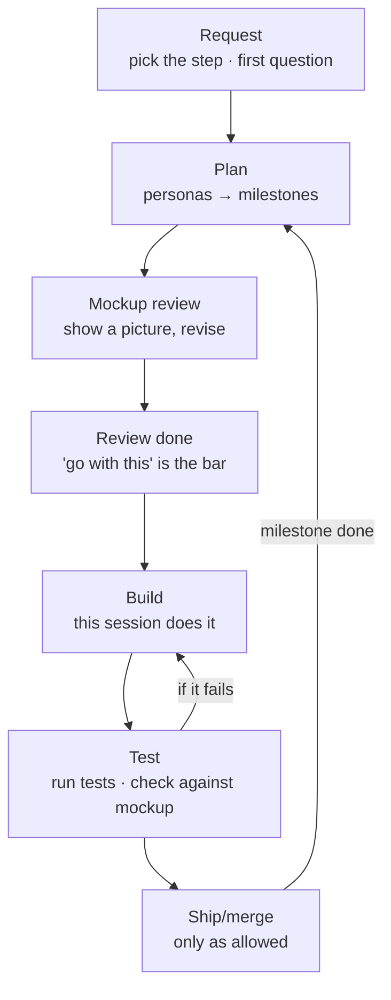

**English** | [한국어](README.ko.md) | [日本語](README.ja.md)

# claude-haejo

**"Claude, do this for me."** A Claude Code skill that hears one request, starts from the right step, and carries it through to the end.

🌱 Website: **https://ff-1204.github.io/claude-haejo/en/**

- **One flow**: request → plan → mockup review → review done → build → test → ship/merge. It starts from the step your request calls for.
- **Planning**: "Plan this from scratch" → writes everything from personas (imagined users) to milestones (development stages).
- **A picture first**: before building, it shows you a mockup as a picture and builds only after you say "go with this".
- **Asks once, up front**: it asks only what this job needs on a single screen. After that it stops only to confirm a mockup or before something hard to undo.

## Getting started

1. Paste this into Claude Code.
   ```text
   Get https://github.com/ff-1204/claude-haejo and install it
   ```
2. Open a new Claude Code session. Skills take effect from the next session.
3. In your project folder, say: **"Plan this from scratch"**

The skill text is written in Korean. Claude follows it and answers in your language.

## Why use it

- **Starts where your request starts.** "Plan this" starts at planning, "add this feature" at the mockup, "fix this bug" at building, and "merge it" only merges.
- **Decides what to build first from people.** It pulls needed features out of each persona's day and orders them by how many people need them.
- **Scores don't drift.** Weight scores are counted by a script (`score.js`), not by eye.
- **Picks up wherever it stopped.** Every document carries an update time and a script checks that the documents agree, so the next session sees which one is stale and why.
- **Mockup as a picture, result as mocked.** For anything you can see — screens, flows, rules — it shows a picture before building and a per-item check against it afterwards.
- **Git only as far as you allow.** It does what you picked up front (files only / commit / PR / merge) or what you tell it ("commit it"), and nothing more.
- **Doesn't take "done" on faith.** It keeps the commands and result lines it ran, and risky changes get a second review by another agent that sees only the change.
- **Easy to read on a phone.** Reports are short and choices are numbered.

## What to say

| Say this | Starts at | What happens |
|---|---|---|
| "Plan this from scratch" | Plan | Researches similar products and the basics its field expects, confirms the core experiences with you, then writes 5 personas → scenarios → scores → priorities → rule mockups → milestones |
| "Add one more persona: an office worker who only plays on weekends" | Plan | Adds that person and their scenario, and updates only what changed downstream |
| "Add this feature" | Mockup review | Shows a picture mockup, then builds and tests once you say "go with this" |
| "Work on M2" | Build | Builds and tests M2's remaining items in order. Each item's "done when" is the bar |
| "Fix this bug" | Build | Fixes and tests straight away, no mockup |
| "Keep testing" | Test | Repeats test → improve for the time you set |
| "Commit it", "Merge it" | Ship/merge | Does exactly that much |
| "I'm going to bed" | — | Asks what it needs before you leave, keeps going, and collects decisions for when you're back |
| "How far along is the roadmap?" | — | Reports done counts per milestone and the next item. Changes nothing |

You can also call it with a slash: `/haejo`. This is the only skill.

## How it works

### The whole flow



- Where you enter depends on what you say. Earlier steps are skipped.
- If testing fails it goes back to building; if the mockup itself was wrong it goes back to mockup review.
- When a milestone ends it updates the scenarios and re-scores, so the next thing to do is always current.

### The first question

It reads the request, looks ahead at how far this job will go, and asks only what's needed on one screen. If there's nothing to ask, no screen appears.

| Question | When it appears | Choices |
|---|---|---|
| Git scope | When files will change | Files only (recommended) / commit / PR / merge |
| Sub-session | When the job is too big for one conversation | This session does it (recommended) / hand it to a sub-session |
| Time | For open-ended work like a test loop | e.g. 3 hours / 6 hours |
| Anything else | Last, whenever a question above appears | No, start now (recommended) / I'll be away |

- Your answers hold for the rest of that session. It doesn't ask again midway.
- If a git action you didn't allow becomes necessary, it doesn't do it and notes "say the word and I'll do this" in the final report.
- Everything else — the model, the `Co-Authored-By: Claude …` trailer on commits (kept by default) — isn't asked; it uses defaults and shows them in one line when it starts. Tell it to change one and it will from then on.

### Building and testing

- **This session does the work.** Sub-sessions (separate Claude conversations) are used only if you chose that in the first question or say "do it in a separate session".
- **The confirmed mockup is the bar.** Nothing outside it gets added, and anything that can't be done as mocked is reported with the reason.
- **Tests leave evidence.** It records the commands, exit codes and result lines as they are, and marks each mockup item "done / not done / done differently".
- **Risky changes** (shared storage or network code, format or version changes, login, payments, secrets, code that deletes things) get one more review by another agent that sees only the change and the bar.
- When it does commit, open a PR or merge, merges are squashed. Commit titles start with a type, like `feat: add login screen`.

## What you decide

Claude decides the rest and reports it, but these are yours.

- **Taste, like core experiences and on-screen wording**: these are things people see and feel, so Claude won't decide them for you. They go into the mockup and are confirmed together.
- **Payments and accounts**: only you handle money and accounts.
- **Git**: **commit** (recording changes), **push** (uploading that record to GitHub), **PR** (a request asking whether changes can be merged) and **merge** (folding a PR into the main branch) happen only within the scope you picked in the first question or the amount you asked for. The default is "files only".
- **Tags** (a name pinned to a point in time, e.g. `v1.0`): only when you ask for one.

## Install and update

You need: [Claude Code](https://claude.com/claude-code), [Git](https://git-scm.com/), Node.js (for scoring), and the [GitHub CLI](https://cli.github.com/) `gh` (for PRs; without it, work stops at push).

Just say it in Claude Code. Either way it takes effect **from the next session**.

| Say this | What Claude does |
|---|---|
| `Get https://github.com/ff-1204/claude-haejo and install it` | Clones the repo and runs `install.sh` (`install.ps1` on Windows) to copy the skill into `~/.claude/skills/` |
| `Update claude-haejo` | Runs `git pull`, shows what will change with `--check` first, then reinstalls |
| `Check my claude-haejo install` | Uses `--check` to list only files that differ between the repo and your install. Copies nothing |

- If `~/.claude/CLAUDE.md` already exists, it isn't overwritten; you're shown the differing lines and decide yourself.
- Machine-only rules (`*.local.md`) are never overwritten. The only deletion is `--prune` cleaning up an old copy that was already moved to `haejo`.
- **Coming from an older version**: the skills were merged into one, `haejo`. If old skill folders (`roadmap`, `roadmap-teammate`, `roadmap-core` and the rest, nine in all) remain, install and check tell you. Left in place, the old skills can keep being called, so remove them with `./install.sh --prune` (PowerShell: `-Prune`). Any `*.local.md` in an old folder is copied to the same place under `haejo` at install time, and a folder holding a `*.local.md` that has no copy is not deleted.
- When a new version is out, the skill tells you in one line at the end of a report. It checks once a day, asks GitHub only for the tag list, and never downloads on its own. To get it, say `Update claude-haejo`.

<details>
<summary>Prefer running the commands yourself?</summary>

```bash
git clone https://github.com/ff-1204/claude-haejo.git
cd claude-haejo
./install.sh             # Windows PowerShell: powershell -ExecutionPolicy Bypass -File .\install.ps1
./install.sh --check     # show differing files without copying (PowerShell: -Check)
./install.sh --dry-run   # show files that would be copied (PowerShell: -DryRun)
./install.sh --prune     # remove old skill folders only (PowerShell: -Prune)
git pull && ./install.sh # update
```

</details>

## Learn more (in Korean)

- The whole flow, the first question and git scope: [skills/haejo/SKILL.md](skills/haejo/SKILL.md)
- Planning flow and where it asks you: [plan.md](skills/haejo/references/plan.md)
- The 5 documents it writes and shared rules: [rules.md](skills/haejo/references/rules.md)
- Picture mockups and checking against them: [mockup.md](skills/haejo/references/mockup.md)
- Testing and review of risky changes: [test.md](skills/haejo/references/test.md)
- Writing private rules that must not be published (`*.local.md`): [projects.md](skills/haejo/references/projects.md)

## License

[MIT](LICENSE)
