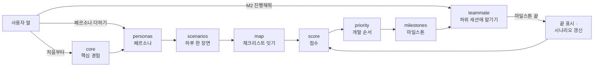
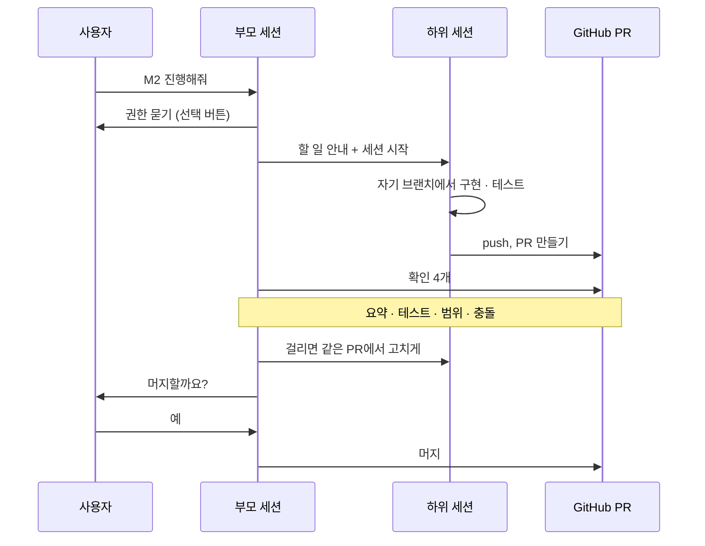

# claude-haejo

**"클로드, ~해줘."** 한 마디로 기획부터 개발까지 맡기는 Claude Code 스킬 묶음입니다.

- **기획**: "처음부터 기획해줘" → 페르소나(가상의 사용자)부터 마일스톤(개발 단계)까지 문서로 만들어 줍니다.
- **개발 맡기기**: "M2 진행해줘" → 일을 하위 세션(따로 도는 Claude 대화)에 팀원처럼 나눠 맡기고, 결과를 확인해 보고합니다.
- **정할 것만 묻기**: 과정은 Claude가 정하고, 취향·돈·되돌리기 어려운 일만 선택 버튼으로 묻습니다.

## 시작하기

```bash
git clone https://github.com/ff-1204/claude-haejo.git
cd claude-haejo
./install.sh    # Windows PowerShell: powershell -ExecutionPolicy Bypass -File .\install.ps1
```

새 Claude Code 세션을 열고, 프로젝트 폴더에서 이렇게 말하세요: **"처음부터 기획해줘"**

## 이렇게 말하세요

| 이렇게 말하면 | 이렇게 됩니다 |
|---|---|
| "처음부터 기획해줘" | 핵심 경험을 확인받고, 페르소나 5명 → 시나리오 → 점수 → 우선순위 → 마일스톤까지 씁니다 |
| "페르소나 하나 더 추가해줘: 주말에만 하는 직장인" | 그 사람과 시나리오를 더하고, 뒤 문서에서 바뀐 곳만 고칩니다 |
| "M2 진행해줘" | 남은 항목마다 하위 세션 하나 = PR(합쳐도 되는지 묻는 요청서) 하나로 맡기고, 확인 뒤 머지(합치기)할지 묻습니다 |
| "자러 갈게" | 떠나기 전에 권한만 묻고 계속 진행합니다. 돌아오면 정할 것을 모아 보여 줍니다 |
| "로드맵 어디까지 왔어?" | 마일스톤마다 끝난 수와 다음 항목만 알려 줍니다. 아무것도 고치지 않습니다 |

`/roadmap`, `/roadmap-teammate`처럼 슬래시로 불러도 됩니다. 기획 단계마다 하위 스킬이 따로 있어(`roadmap-core`, `-personas`, `-scenarios`, `-map`, `-score`, `-priority`, `-milestones`) 혼자 부를 수도 있습니다.

## 어떻게 움직이나

### 기획 흐름



- 말에 따라 들어가는 곳이 다릅니다. "페르소나 하나 더"는 처음부터 다시 하지 않고 personas부터 돕니다.
- 핵심 경험(사용자가 이 제품으로 하는 일 3~6개)은 "알아서 끝까지"라고 해도 꼭 확인받습니다. 여기가 틀리면 뒤가 모두 헛돕니다.
- 개발이 끝나면 시나리오를 갱신하고 점수를 다시 봅니다. 그래서 다음에 할 일이 늘 최신입니다.

### 하위 세션과 PR



- 하위 세션은 자기 브랜치(본 줄기에서 갈라진 가지)에서 일해서, 여러 일이 동시에 돌아도 서로 부딪히지 않습니다.
- 부모 세션은 코드를 다시 읽지 않고 PR에서 네 가지만 봅니다: 요약이 다 찼나, 테스트가 통과하나, 맡긴 범위 안인가, 충돌이 없나.
- 사용자가 정하는 곳은 시작할 때 권한, 머지 직전 "예" 두 곳뿐입니다.

## 사용자에게 꼭 묻는 것

나머지는 Claude가 정하고 보고하지만, 이것들은 묻습니다.

- **핵심 경험·화면 문구 같은 취향**: 사람이 보고 느끼는 것이라 Claude가 대신 정하지 않습니다.
- **결제·계정**: 돈과 계정은 사용자만 다룹니다.
- **커밋**(바뀐 내용을 기록으로 남기기)·**push**(그 기록을 GitHub에 올리기)
- **PR**(변경을 합쳐도 되는지 묻는 요청서)·**머지**(PR을 본 줄기 main에 합치기)
- **태그**(특정 시점에 붙이는 이름표, 예: `v1.0`)

커밋부터 태그까지는 기록으로 남고, 남에게 보이고, 배포로 이어질 수 있습니다. 그래서 "알아서 해줘"라고 해도 스킬을 쓸 때마다 묻습니다. 고르는 것은 셋입니다: **PR까지 맡기고 머지는 묻기**(추천) / 이번만 머지까지 맡기기 / 그때마다 묻기.

## 설치·업데이트

필요한 것: [Claude Code](https://claude.com/claude-code), Node.js(점수 계산), [GitHub CLI](https://cli.github.com/) `gh`(PR 만들기, 없으면 push까지만).

```bash
./install.sh --check     # 복사하지 않고 다른 파일만 보기 (PowerShell: -Check)
./install.sh --dry-run   # 복사할 파일만 보기 (PowerShell: -DryRun)
```

- `skills/*`를 `~/.claude/skills/`에 복사합니다. 새 세션부터 적용됩니다.
- `~/.claude/CLAUDE.md`가 이미 있으면 덮지 않고 다른 줄만 보여 줍니다.
- 업데이트: `git pull` 뒤 다시 `./install.sh`.

## 더 알아보기

- 기획 플로우와 묻는 지점: [skills/roadmap/SKILL.md](skills/roadmap/SKILL.md)
- 만드는 문서 5개와 공통 규칙: [skills/roadmap/references/rules.md](skills/roadmap/references/rules.md)
- 하위 세션·PR·머지, 테스트 반복, 자리 비움: [skills/roadmap-teammate/SKILL.md](skills/roadmap-teammate/SKILL.md)
- 공개하면 안 되는 개인 규칙(`*.local.md`) 쓰는 법: [projects.md](skills/roadmap-teammate/references/projects.md)
- 과정 전체를 사람이 읽기 좋게: [playbooks/persona-roadmap/README.md](playbooks/persona-roadmap/README.md)
