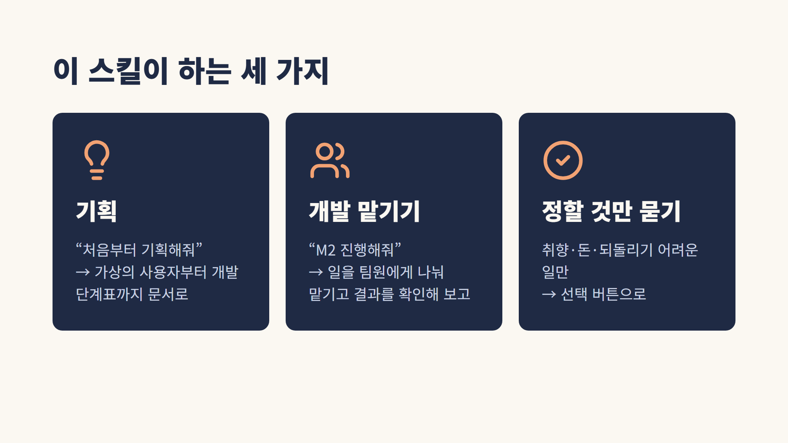
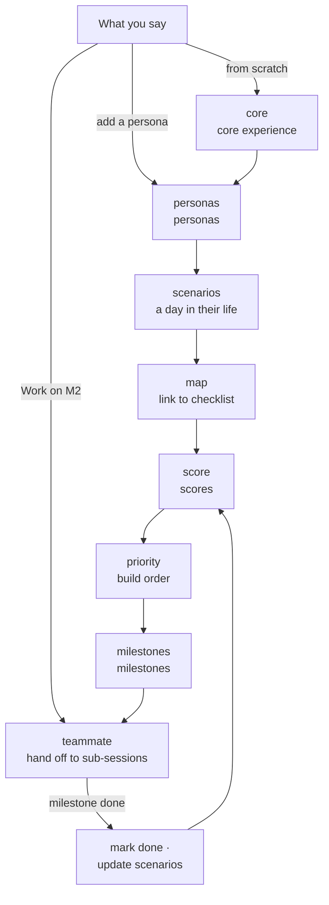
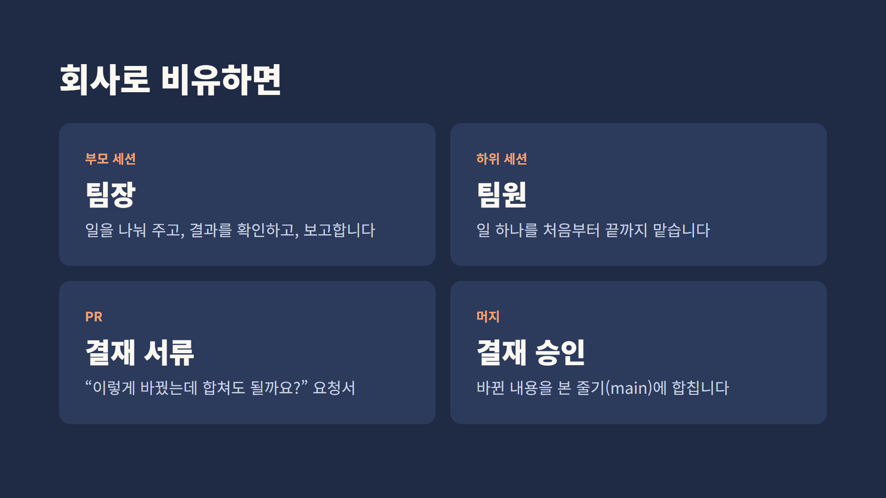
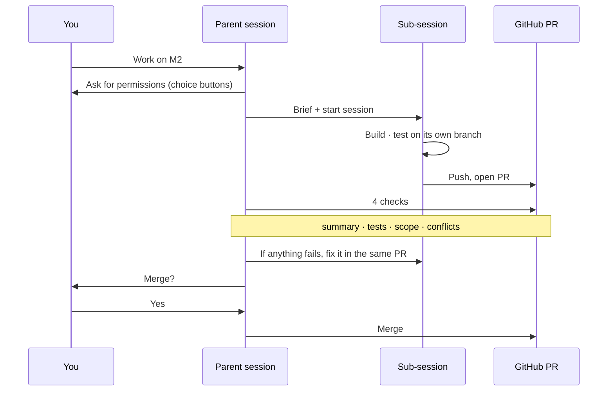
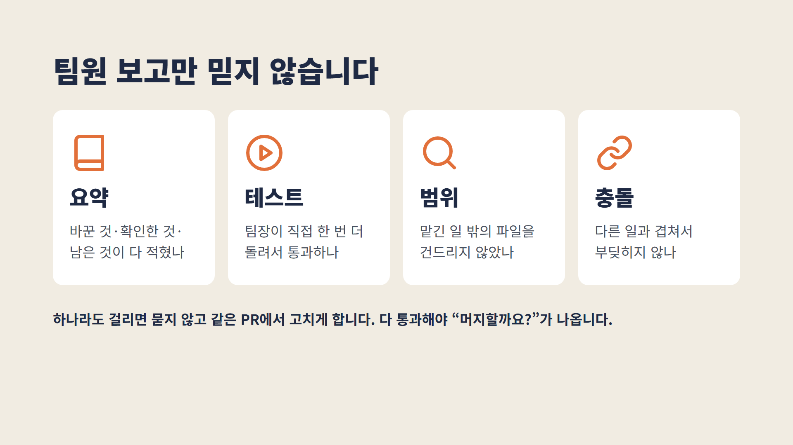

**English** | [한국어](README.ko.md) | [日本語](README.ja.md)

# claude-haejo

**"Claude, do this for me."** A set of Claude Code skills that takes you from planning to shipping with plain requests.

- **Planning**: "Plan this from scratch" → writes everything from personas (imagined users) to milestones (development stages).
- **Delegating work**: "Work on M2" → splits the work across sub-sessions (separate Claude conversations) like teammates, then checks the results and reports back.
- **Asks only what's yours to decide**: Claude handles the process and asks, with choice buttons, only about taste, money, and things that are hard to undo.

The skills themselves are written in Korean, but every document and question they produce is in your language (see "Writing" in [rules.md](skills/roadmap/references/rules.md)).



## Getting started

1. Paste this into Claude Code:
   ```text
   Download https://github.com/ff-1204/claude-haejo and install it
   ```
2. Open a new Claude Code session. Skills take effect from the next session.
3. In your project folder, say: **"Plan this from scratch"**

## Why use it

- **Decides what to build first, based on people.** It pulls the features each persona needs from a day in their life and orders them by how many people need them.
- **Scores you can trust.** Priority scores are counted by a script (`score.js`), not eyeballed by Claude.
- **Picks up where it left off.** Every document carries an updated-at timestamp, so the next session sees which document is stale and resumes there.
- **Parallel work without collisions.** One task = one sub-session = one branch = one PR.
- **Doesn't just take a report's word for it.** The parent session checks four things on each PR (summary, tests, scope, conflicts) before asking you to merge.
- **Phone-friendly.** Reports are short, and choices are numbered.

## Things to say

| Say this | What happens |
|---|---|
| "Plan this from scratch" | Confirms the core experience with you, then writes 5 personas → scenarios → scores → priorities → milestones |
| "Add one more persona: an office worker who only plays on weekends" | Adds that person and their scenario, and updates only what changes in the later documents |
| "Work on M2" | Hands each remaining item to its own sub-session = one PR (a request to merge changes), checks it, then asks whether to merge |
| "I'm going to bed" | Asks for permissions before you leave and keeps going. When you're back, it shows you everything that needs a decision |
| "Where are we on the roadmap?" | Shows, per milestone, how many items are done and what's next. Changes nothing |

You can also call them as slash commands, like `/roadmap` or `/roadmap-teammate`. Each planning stage has its own sub-skill (`roadmap-core`, `-personas`, `-scenarios`, `-map`, `-score`, `-priority`, `-milestones`) that you can run on its own.

## How it works

### Planning flow



- Where it starts depends on what you say. "Add one more persona" doesn't start over; it runs from personas onward.
- The core experience (the 3–6 things users do with your product) is always confirmed with you, even if you say "just finish it all." If that's wrong, everything after it is wasted.
- When development finishes, it updates the scenarios and rescores, so the next thing to do is always current.

### Sub-sessions and PRs





- Each sub-session works on its own branch (a line of work split off from the main line), so many tasks can run at once without stepping on each other.
- The parent session doesn't reread the code. It checks four things on the PR: is the summary complete, do the tests pass, is it within the assigned scope, are there no conflicts.
- Merges are squashed: each PR lands as one commit that lists only the results.
- You decide in just two places: permissions at the start, and "yes" right before a merge.



## What it always asks you

Claude decides and reports everything else, but it always asks about these:

- **Taste, like the core experience or on-screen wording**: people see and feel these, so Claude doesn't decide for you.
- **Payments and accounts**: only you handle money and accounts.
- **Commit** (saving changes as a record) · **push** (uploading those records to GitHub)
- **PR** (a request to merge changes) · **merge** (folding a PR into the main line, `main`)
- **Tag** (a name pinned to a point in history, e.g. `v1.0`)

From commit to tag, things become permanent records, become visible to others, and can lead to a release. So even when you say "handle it," it asks every time a skill runs. You pick one of three: **hand off up to the PR, ask before merging** (recommended) / hand off through merge, this run only / ask every time.

On the same screen you also pick the `Co-Authored-By: Claude …` line (trailer) at the end of commits: **keep it** (recommended) / drop it and add one line like "Done with Claude" to the body / drop both.

## Install and update

You'll need: [Claude Code](https://claude.com/claude-code), [Git](https://git-scm.com/), Node.js (for scoring), and the [GitHub CLI](https://cli.github.com/) `gh` (for opening PRs; without it, Claude stops at push).

Just ask in Claude Code. Every change takes effect **from the next new session**.

| Say this | What Claude does |
|---|---|
| `Download https://github.com/ff-1204/claude-haejo and install it` | Clones the repo and runs `install.sh` (`install.ps1` on Windows), copying the skills into `~/.claude/skills/` |
| `Update claude-haejo` | Runs `git pull`, shows what will change with `--check` first, then reinstalls |
| `Check my claude-haejo install` | Uses `--check` to list only files that differ between the repo and your install. Copies nothing |

- If `~/.claude/CLAUDE.md` already exists, it isn't overwritten; you're shown the differing lines and decide yourself.
- Machine-only rules (`*.local.md`) are never copied or deleted.

<details>
<summary>Prefer running the commands yourself?</summary>

```bash
git clone https://github.com/ff-1204/claude-haejo.git
cd claude-haejo
./install.sh             # Windows PowerShell: powershell -ExecutionPolicy Bypass -File .\install.ps1
./install.sh --check     # show differing files without copying (PowerShell: -Check)
./install.sh --dry-run   # show files that would be copied (PowerShell: -DryRun)
git pull && ./install.sh # update
```

</details>

## Learn more (in Korean)

- Intro slides for newcomers (13 slides, Korean): [docs/presentation.md](docs/presentation.md)
- Planning flow and where it asks you: [skills/roadmap/SKILL.md](skills/roadmap/SKILL.md)
- The 5 documents it writes and shared rules: [skills/roadmap/references/rules.md](skills/roadmap/references/rules.md)
- Sub-sessions, PRs, merging, test loops, working while you're away: [skills/roadmap-teammate/SKILL.md](skills/roadmap-teammate/SKILL.md)
- Writing private rules that must not be published (`*.local.md`): [projects.md](skills/roadmap-teammate/references/projects.md)
- The whole process, written for people: [playbooks/persona-roadmap/README.md](playbooks/persona-roadmap/README.md)
