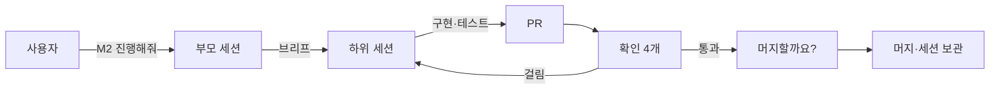

# claude-haejo

**"클로드, ~해줘."** 한 마디로 기획부터 개발 반복까지 맡기는 Claude Code 스킬 묶음이다.

- **기획**: "처음부터 기획해줘"라고 하면 핵심 경험 → 페르소나 → 시나리오 → 점수 → 우선순위 → 마일스톤까지 문서 다섯 개로 만들어 준다.
- **개발**: "M2 진행해줘"라고 하면 항목마다 하위 세션을 만들어 팀원처럼 맡기고, 결과는 PR 하나로 받아 확인한 뒤 머지할지 묻는다.
- **정할 것만 묻는다**: 과정은 Claude가 정하고, 취향·공개·돈·커밋/머지처럼 사용자가 정할 것만 선택 버튼으로 한 번에 묻는다.

Claude Code를 쓰면서 "무엇부터 만들지"와 "여러 작업을 어떻게 나눠 맡길지"를 덜 고민하고 싶은 사람에게 맞다. 게임·앱·도구 어느 프로젝트에나 쓴다.

## 빨리 시작하기

```bash
git clone https://github.com/ff-1204/claude-haejo.git
cd claude-haejo
./install.sh            # Windows PowerShell: powershell -ExecutionPolicy Bypass -File .\install.ps1
```

새 Claude Code 세션을 열고 프로젝트 폴더에서 이렇게 말한다.

```
처음부터 기획해줘
```

자세한 설치 옵션은 아래 [설치](#설치)에 있다.

## 이렇게 말하면 이렇게 된다

| 이렇게 말하면 | 이렇게 된다 |
|---|---|
| "처음부터 기획해줘" | 핵심 경험 확인 → 페르소나 5명 → 사람마다 "하루 한 장면" 시나리오 → 체크리스트에 잇기 → 비중 점수 → 우선순위 → 마일스톤. 핵심 경험은 꼭 확인받는다 |
| "페르소나 하나 더 추가해줘: 주말에만 하는 직장인" | 그 사람과 시나리오를 더하고, 점수·우선순위·로드맵에서 바뀐 곳만 고친다 |
| "M2 진행해줘" | M2의 남은 항목마다 하위 세션 하나 = 브랜치 하나 = PR 하나. 부모 세션이 확인 4개를 본 뒤 머지할지 묻는다 |
| "M2 끝났어" | 로드맵에 ✅ 표시 → 시나리오의 🔜를 ✅로 → 점수·우선순위 다시 계산 |
| "테스트 반복해줘" | 테스트 → 개선 → 커밋을 회차로 돈다. 테스트 세션은 코드를 고치지 않고 보고서만 쓴다 |
| "자러 갈게" | 떠나기 전에 커밋·PR·머지 권한만 한 번 묻고, 그 뒤로는 묻지 않고 진행한다. 돌아오면 "확인해 주세요"와 "돌아오시면 정할 것"을 모아 보여 준다 |
| "로드맵 어디까지 왔어?" | 마일스톤마다 ✅ 수와 다음 항목만 보고한다. 아무것도 고치지 않는다 |

`/roadmap`, `/roadmap-teammate`처럼 슬래시로 불러도 된다. 하위 스킬은 `/roadmap-score`처럼 혼자도 부를 수 있다.

## 흐름

### 기획에서 개발까지


개발이 끝날 때마다 시나리오가 갱신되고, 점수와 우선순위를 다시 본다. 문서마다 갱신 시각이 있어서 어느 단계가 낡았는지 알고 거기서부터 이어 한다.

### 하위 세션과 PR



부모 세션은 코드를 다시 읽지 않고 PR에서 네 가지만 본다.

1. PR 본문이 네 칸(무엇을 바꿨나 · 어떻게 확인했나 · 범위 밖 · 남은 것)을 다 채웠나
2. CI나 테스트가 통과하나
3. 바뀐 파일이 맡긴 범위 안인가
4. 기본 브랜치와 충돌이 없나

## 누가 정하나

| 사용자가 정한다 | Claude가 정하고 보고한다 |
|---|---|
| 핵심 경험, 마일스톤 경계 | 진행 방식, 페르소나 수(기본 5명) |
| 화면 문구·보상·처음 흐름처럼 사람이 보는 것 | 매핑·점수·개발 순서 |
| 커밋·push·PR·머지·태그 (스킬을 쓸 때마다 묻는다) | 비공개 저장소의 문서 위치 |
| 공개 저장소에 기획 문서를 둘지 | 어려운 것·사람 확인이 필요한 것을 뒤로 미루기 |
| 결제·계정·공개 전환 (사용자만 한다) | 내부 구조·코드·데이터 형식 |

물을 때는 선택 버튼으로 한 번에 묻고, 추천을 첫 번째에 둔다. "결재 빼고 알아서"라고 해도 커밋·push·PR·머지·태그는 따로 묻는다.

## 만드는 문서 5개

| 문서 | 내용 |
|---|---|
| `personas.md` | 맨 위에 핵심 경험·범위, 아래에 페르소나(한 명당 다섯 줄) |
| `persona-scenarios.md` | 사람마다 하루 한 장면 5~8단계, 단계마다 ✅ 됨 / 🔜 계획됨 / ❌ 계획에 없음 |
| 체크리스트 | 프로젝트에 있던 것을 쓰고, 없으면 `checklist.md`를 만든다. 번호는 바꾸지 않는다 |
| `persona-checklist-map.md` | 시나리오 단계 ↔ 체크리스트 번호, 비중 점수 표, 개발 순서 |
| `roadmap.md` | 날짜 없는 마일스톤과 세부 항목(한 줄 = 하위 세션 하나 = PR 하나) |

비중 점수는 `필요한 사람 수 × 2 + 나온 시나리오 단계 수`이고, `score.js`가 센다.

## 설치

필요한 것:

- [Claude Code](https://claude.com/claude-code)
- Node.js — 비중 점수 스크립트(`score.js`)를 돌릴 때
- [GitHub CLI](https://cli.github.com/)(`gh`) — 하위 세션이 PR을 만들 때. 없으면 브랜치 push까지만 한다

Git Bash, macOS, Linux:

```bash
./install.sh             # 설치
./install.sh --dry-run   # 복사할 파일만 보기
./install.sh --check     # 복사하지 않고 다른 파일만 보기 (다르면 exit 1)
```

Windows PowerShell:

```powershell
powershell -ExecutionPolicy Bypass -File .\install.ps1            # 설치
powershell -ExecutionPolicy Bypass -File .\install.ps1 -DryRun    # 복사할 파일만 보기
powershell -ExecutionPolicy Bypass -File .\install.ps1 -Check     # 다른 파일만 보기
```

- `skills/*`를 `~/.claude/skills/`에 복사한다.
- `CLAUDE.md`는 `~/.claude/CLAUDE.md`가 없을 때만 복사한다. 이미 있고 다르면 덮지 않고 다른 줄만 보여 준다. 필요한 줄은 손으로 합친다.
- `*.local.md`(아래 개인 규칙)는 복사하지도 비교하지도 않는다. `~/.claude`에만 있는 파일은 지우지 않는다.
- 새 Claude Code 세션부터 적용된다.

## 업데이트

```bash
git pull
./install.sh --check   # 무엇이 달라졌는지 먼저 보기
./install.sh
```

- `~/.claude`에서 직접 고친 것은 이 저장소에 복사해 커밋한다. `--check`로 빠뜨린 파일이 없는지 본다.
- 저장소에서 지운 파일은 `~/.claude`에서 지우지 않고 "저장소에 없음"으로 알리기만 한다.

## 개인 규칙

저장소 이름, 커밋 작성자, 내부 경로처럼 공개하면 안 되는 프로젝트 규칙은 `~/.claude/skills/roadmap-teammate/references/projects.local.md`에만 둔다. `*.local.md`는 git에 올라가지 않는다. 쓰는 형식은 [projects.md](skills/roadmap-teammate/references/projects.md)의 템플릿을 따른다.

## 폴더 구조

| 경로 | 내용 |
|---|---|
| [`CLAUDE.md`](CLAUDE.md) | 모든 프로젝트에 적용되는 작업 방식 (`~/.claude/CLAUDE.md`로 설치) |
| [`skills/roadmap/`](skills/roadmap/SKILL.md) | 기획 상위 스킬. 말에 맞는 플로우를 골라 하위 스킬을 부른다. 공통 규칙은 [`references/rules.md`](skills/roadmap/references/rules.md) |
| `skills/roadmap-*/` | 하위 스킬 7개: [core](skills/roadmap-core/SKILL.md), [personas](skills/roadmap-personas/SKILL.md), [scenarios](skills/roadmap-scenarios/SKILL.md), [map](skills/roadmap-map/SKILL.md), [score](skills/roadmap-score/SKILL.md), [priority](skills/roadmap-priority/SKILL.md), [milestones](skills/roadmap-milestones/SKILL.md) |
| [`skills/roadmap-teammate/`](skills/roadmap-teammate/SKILL.md) | 하위 세션에 맡기기, PR과 머지, 테스트 반복, 자리 비움·마무리 |
| [`playbooks/persona-roadmap/`](playbooks/persona-roadmap/README.md) | 위 과정을 사람이 읽는 개요 |
| `install.sh`, `install.ps1` | 설치·점검 스크립트 |

## 더 읽기

- 과정 전체를 사람이 읽기 좋게: [playbooks/persona-roadmap/README.md](playbooks/persona-roadmap/README.md)
- 스킬로 나눈 이유: [playbooks/persona-roadmap/skills-plan.md](playbooks/persona-roadmap/skills-plan.md)
- 기획 플로우와 묻는 지점: [skills/roadmap/SKILL.md](skills/roadmap/SKILL.md)
- 하위 세션·PR·머지 규칙: [skills/roadmap-teammate/SKILL.md](skills/roadmap-teammate/SKILL.md)
- 테스트 반복: [qa-loop.md](skills/roadmap-teammate/references/qa-loop.md) · 자리 비움과 마무리: [wrap-up.md](skills/roadmap-teammate/references/wrap-up.md)
